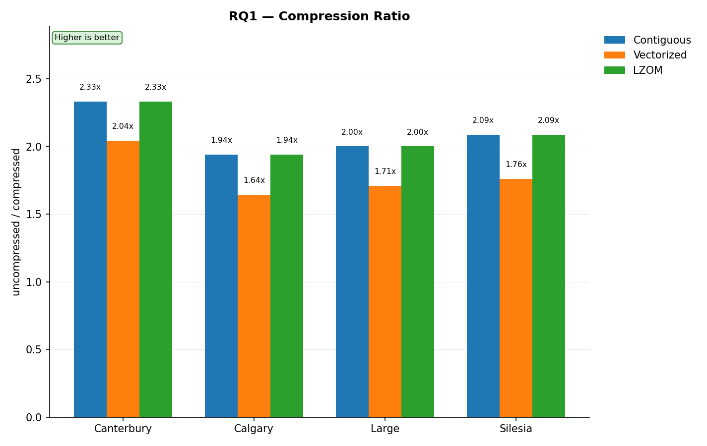
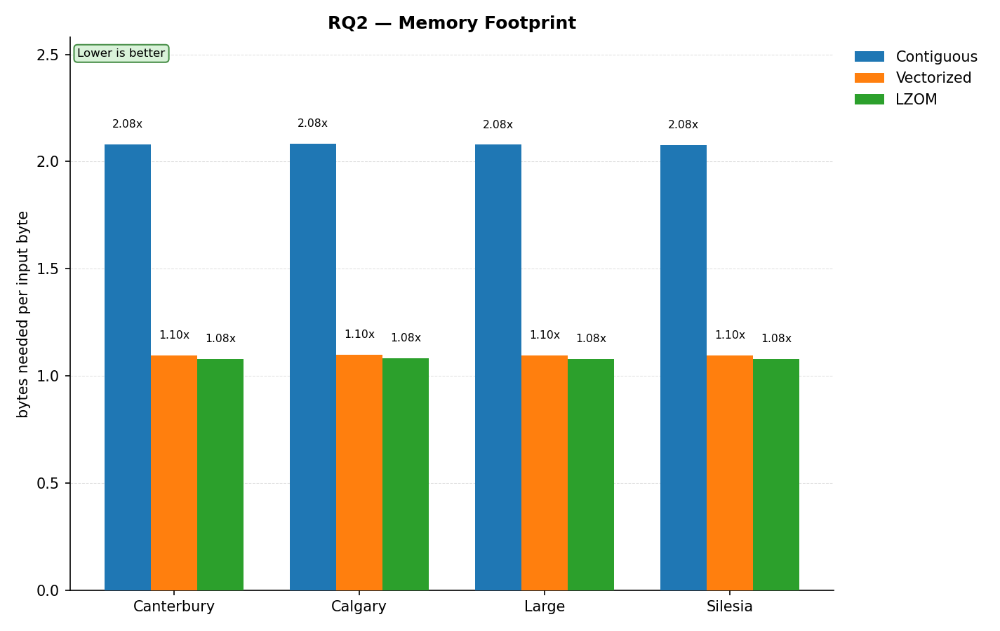
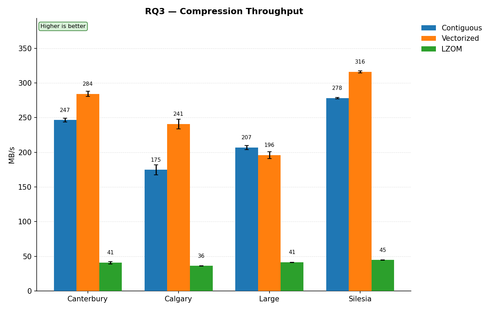
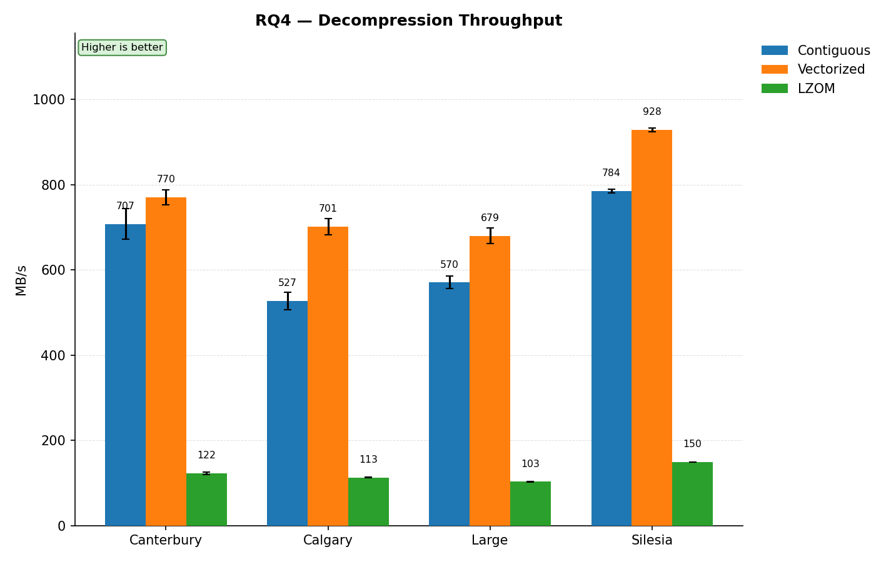

# LZOM compression experiment

Compares three ways of LZO1X-compressing a block I/O request inside the Linux
kernel. Each write request is a bio whose data sits in scattered pages
(`bi_io_vec`):

- **Contiguous** — copy every page of the request into one flat buffer, then
  compress that buffer with the kernel's own `lzorle1x_1_compress()`.
- **Vectorized** — compress each segment (`bio_vec`) independently with the same
  kernel API.
- **LZOM** — `lzom_compress()` from this repo, reading straight across the
  scattered pages via `struct lzom_sg_buf`, no copy at all.

All three share `LZO_VERSION=1` (zero-run RLE) and 16 KiB of work memory, and
each write is decompressed back with the matching decompressor, so the
measured time includes decompression. The only difference between the methods
is how the input is accessed, which is exactly what RQ1–RQ4 measure.

The experiment runs inside `lzom_module.ko`, a block device proxy over a RAM
disk (`brd`): every write is compressed with the selected method, decompressed,
and the verified original bytes are written to the RAM disk. Reads pass through
unchanged. Timings come from `ktime_get_ns()` counters in the module, exposed
through sysfs.

## Experimental setup

| | |
|---|---|
| CPU | Intel Core i5-13500H (12 vCPU, virtualized) |
| RAM | 10 GiB |
| OS | Fedora Linux 42 (Server Edition), kernel 6.15.7-200.fc42.x86_64 |
| Compiler | gcc 15.1.1,`-O2` |
| Datasets | 4 public corpora, 44 files, ~223 MB total (see below) |
| Request size | `dd bs=1M` (full blocks), tail as one request |
| Repetitions | 15 per (corpus, method), plus one discarded warm-up run |

## Datasets

Each corpus in `dataset/` is concatenated into one file, which is then written
through the device in full, as in the report. \

| Dataset | Files | What it is | Size after concatenation |
|---|---|---|---|
| `calgary` | 18 | Classic mixed-text dataset | 3.3 MB |
| `canterbury` | 11 | Classic mixed-text dataset | 2.8 MB |
| `large` | 3 | A few large real files (Bible text, World Fact Book) | 11.2 MB |
| `silesia` | 12 | Large mixed real-world files | 211.9 MB |

## Questions & answers

Numbers below are from the run captured in `result/kernel_results.csv`;
regenerate the charts with `python3 plot.py`.

### RQ1 — compression ratio

$$
\mathrm{ratio} = \frac{\mathrm{uncompressed\_bytes}}{\mathrm{compressed\_bytes}}
$$

*Ratio of the whole corpus, per corpus. The ratio is identical in every
repetition, so the chart shows the value only.*



LZOM matches Contiguous exactly on every corpus — same dictionary, same
bitstream, only the access pattern differs, so the compressed size is
byte-identical. Vectorized loses 12–16% of the ratio everywhere, because each
segment starts with a fresh, empty dictionary and can never reference an
earlier segment.

### RQ2 — memory footprint

$$
\mathrm{memory} = \mathrm{source\_bytes} + \mathrm{dest\_worst\_case\_bytes} + \mathrm{workmem\_bytes}
\qquad
$$
$$
\mathrm{RQ2} = \frac{\mathrm{memory}}{\mathrm{uncompressed\_bytes}}
$$

*Bytes needed per byte of input, lower is better.*



Contiguous needs about 2.1x the input size in memory on every corpus. LZOM needs none of that
source copy, cutting memory by **48%** relative to Contiguous on every corpus.
Vectorized also skips the copy but allocates a separate destination per
segment, so it lands a little above LZOM (1.10x against 1.08x).

### RQ3 — compression throughput

$$
\mathrm{mbps} = \frac{\mathrm{uncompressed\_bytes}}{\mathrm{copy\_time} + \mathrm{compress\_time}}
$$

*Mean MB/s over 15 repetitions, with the standard error of the mean as the
whisker. For Contiguous the copy is part of the method's cost.*



Vectorized and Contiguous are close to each other (Contiguous is faster on
Canterbury, Vectorized on the other corpora), and LZOM is 4.8–6.2x slower than
Contiguous. That's the price of walking a `bvec_iter` across page
boundaries one segment at a time instead of doing a linear scan over one
pointer.

### RQ4 — decompression throughput

$$
\mathrm{mbps}_{\mathrm{decomp}} = \frac{\mathrm{uncompressed\_bytes}}{\mathrm{decompress\_time}}
$$

*Mean MB/s over 15 repetitions, with the standard error of the mean as the
whisker.*



Decompression follows the same pattern: Contiguous and Vectorized decompress at 350–928 MB/s, LZOM at 103–150 MB/s, 4.7–5.8x slower.

## Reproducing

Requires root, the kernel headers the module is built against, `dd` with
`seek_bytes` support and Python 3 with matplotlib.

```bash
# from the repository root
make                                        # builds lzom_module.ko
cd experiment
sudo python3 kernel_bench.py --reps 15      # writes result/kernel_results.csv
python3 plot.py                             # writes result/rq{1..4}_*.png, prints a table
```

`kernel_bench.py` loads and unloads `brd` and `lzom_module` itself, so don't
run it while another instance is loaded.

`dataset/` isn't tracked in git (about 223 MB) — repopulate it from the original sources:

- Calgary / Canterbury / Large: `corpus.canterbury.ac.nz/descriptions/`
- Silesia: `github.com/MiloszKrajewski/SilesiaCorpus`

## Caveats

- The machine is a VM, so absolute MB/s are indicative. Methods run one after
  another in each repetition, and the order is fixed, so drift in the host can
  affect methods differently.
- The last part of each corpus is cut to a multiple of 4 KiB (at most 4 KiB is
  dropped).
- Each corpus is written as 1 MiB requests. Real block I/O sizes vary, and
  other request sizes are not measured here.
